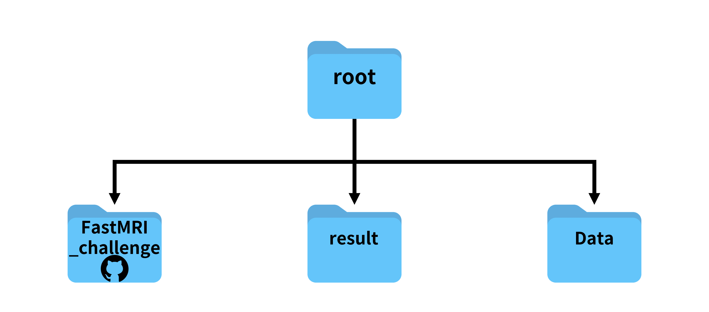
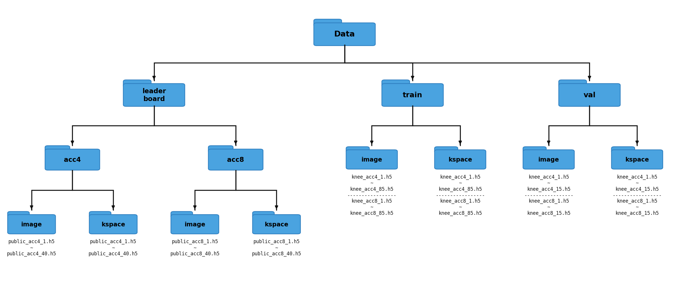

# silicaMagos FastMRI: acceleration-aware E2E-VarNet

Team entry for the **2026 SNU FastMRI Challenge** (knee annotation track): reconstructing
384x384 knee MR images from 4x- and 8x-undersampled multi-coil k-space, scored by SSIM over the
foreground and over lesion bounding boxes, plus per-slice reconstruction time.

Starting from the organiser's "baby VarNet" baseline (an End-to-End Variational Network), we
made two kinds of changes:

- **Acceleration-aware dual network.** Two VarNets, one specialised per undersampling factor,
  selected per input by a deterministic classifier that reads only the undersampling mask. The
  baseline trained one network blindly on the acc4/acc8 mix; filenames and metadata may not be
  used, so the mask itself is the routing signal. Details in [docs/acc_routing.md](docs/acc_routing.md).
- **Training pipeline upgrades** that let the full-size 12-cascade model train on an 8 GB GPU
  and converge faster: OneCycle learning-rate schedule, gradient clipping, gradient
  accumulation, per-cascade gradient checkpointing, checkpoint auto-resume and warm start,
  and parallel data loading. Each change has a design note under [docs/](docs/).

## Results

Scores are produced by the organiser's fixed harness (`recon_eval.py`) on the leaderboard set,
averaged over acc4 and acc8. Timing is the mean model forward time per slice at batch size 1.

| Model | SSIM_full | SSIM_bbox | ms / slice |
|---|---|---|---|
| Baseline single VarNet (3 cascades, 12 ch, 6 sens ch) | TODO | TODO | TODO |
| **Dual VarNet, final** (12 cascades, 18 ch, 8 sens ch) | TODO | TODO | TODO |

Per-acceleration detail of the final model:

| | SSIM_full | SSIM_bbox | ms / slice |
|---|---|---|---|
| acc4 | TODO | TODO | TODO |
| acc8 | TODO | TODO | TODO |

## Method

### E2E-VarNet recap

The baseline is the End-to-End Variational Network of Sriram et al. [2]. A small U-Net
estimates coil sensitivity maps from the auto-calibration region, then `num_cascades`
unrolled blocks each apply a soft data-consistency step in k-space and a U-Net regulariser in
the image domain. The final k-space estimate is inverse-Fourier-transformed, root-sum-of-squares
combined over coils and centre-cropped to 384x384. Training minimises an SSIM loss against the
fully sampled target.

### Acceleration-aware dual network

```
masked k-space ─┐
                ├─► classify_acc(mask) ─┬─ acc4 ─► VarNet-4 ─┐
mask ───────────┘                       └─ acc8 ─► VarNet-8 ─┴─► RSS ─► 384x384 image
```

`AccVarNet` (`utils/model/acc_varnet.py`) wraps two structurally identical VarNets. The router
`classify_acc` computes the mask's sampling ratio and compares it to a fixed threshold of 0.25.
Measured over every training volume, acc4 masks sample 30.9 to 31.2 percent of k-space lines
and acc8 masks 19.6 to 20.0 percent, so the rule has more than a 20 percent relative margin on
each side and was correct on all training volumes. The mask is a normal model input (the
data-consistency term already needs it), so no filename or metadata is consulted.

In mixture-of-experts terms this is a two-expert layout with a **hard, non-learned gate**: a
fixed threshold selects exactly one expert, so inference costs the same as a single VarNet while
each expert only ever sees its own undersampling regime. Both experts are trained in a single
run; each batch updates only the expert it was routed to.

### Training improvements

| Change | Flag / location | Why | Note |
|---|---|---|---|
| OneCycle LR schedule | `-l` sets the peak LR | Faster convergence than a constant LR; stepped per optimizer step | [docs/optimization-1cycle-lr.md](docs/optimization-1cycle-lr.md) |
| Gradient-norm clipping (1.0) | always on, `train_part.py` | Unrolled cascades are prone to gradient spikes near the LR peak | [docs/optimization-gradient-clipping.md](docs/optimization-gradient-clipping.md) |
| Gradient accumulation | `--accumulation_steps N` | Larger effective batch while memory forces batch size 1 | [docs/optimization-gradient-accumulation.md](docs/optimization-gradient-accumulation.md) |
| Gradient checkpointing | `--grad-checkpointing` | Peak memory no longer scales with cascade count (about 30% extra compute) | [docs/optimization-gradient-checkpointing.md](docs/optimization-gradient-checkpointing.md) |
| Auto-resume from best checkpoint | default; `--no-resume` to disable | Restart long runs without losing progress | `train_part.py::train` |
| Warm start from a single VarNet | `--init-from <best_model.pt>` | Initialise both experts from an already trained single network | [docs/acc_routing.md](docs/acc_routing.md) |
| Parallel data loading | `--num-workers` (default 4) | Pinned memory, prefetching and persistent workers | `utils/data/load_data.py` |
| Per-acceleration validation | printed as `Val(acc4)` / `Val(acc8)` | See which regime is lagging during training | `train_part.py::validate` |

## Repository layout

```
├── train.py                 # training entry point (CLI below)
├── reconstruct.py           # reconstruct the leaderboard set with best_model.pt
├── recon_eval.py            # organiser's fixed harness: reconstruct + score + time (do not edit)
├── leaderboard_eval.py      # score reconstructions already on disk
├── *.sh                     # ready-made invocations of the scripts above
├── requirements.txt
├── docs/                    # design notes and data-layout figures
└── utils
    ├── common
    │   ├── loss_function.py # SSIM loss
    │   ├── metrics.py       # SSIM_full / SSIM_bbox scoring (organiser's, do not edit)
    │   └── utils.py         # seeding, h5 writing, validation SSIM
    ├── data
    │   ├── load_data.py     # SliceData dataset + DataLoader factory
    │   └── transforms.py    # k-space / mask tensor preparation
    ├── learning
    │   ├── train_part.py    # training loop, validation, checkpointing
    │   └── test_part.py     # load_model / prep_volume / recon_slice contract used by recon_eval.py
    └── model
        ├── acc_varnet.py    # AccVarNet: mask classifier + two VarNets
        ├── varnet.py        # E2E-VarNet (sensitivity model + cascades, gradient checkpointing)
        ├── unet.py          # U-Net regulariser
        └── fastmri/         # vendored fastMRI ops (FFT, complex math, coil combine)
```

`recon_eval.py` and `utils/common/metrics.py` are re-run unchanged by the organisers for
scoring and timing. The harness only calls `load_model`, `prep_volume` and `recon_slice` from
`utils/learning/test_part.py`; everything under `utils/model/` and `utils/learning/` is ours
to change.

## Setup

Python 3.12 and a CUDA GPU. The final configuration trains within 8 GB of VRAM with
`--grad-checkpointing`; without it the 12-cascade model needs considerably more.

```bash
pip install -r requirements.txt
```

## Data layout

The scripts expect the challenge layout below next to the repository. Paths are passed with
`-t`, `-v` and `-p`, or by setting `DATA=/path/to/Data` before running the `.sh` wrappers.

```
Data/
├── train/      image/knee_{acc4,acc8}_{1..85}.h5   kspace/knee_{acc4,acc8}_{1..85}.h5
├── val/        image/knee_{acc4,acc8}_{1..15}.h5   kspace/knee_{acc4,acc8}_{1..15}.h5
└── leaderboard/{acc4,acc8}/{image,kspace}/knee_test{1..29}.h5
```

- k-space files hold `kspace` (slices, coils, 640, W) and `mask` (W,). Width W varies between
  320 and 480, which is why batch size is 1.
- image files hold `image_label` (fully sampled target), `image_input`, `image_grappa`, the
  `max` attribute used as SSIM data range, and lesion boxes in `attrs['annotations']`.
- The leaderboard set is never used for training. Results go to `../result/<net_name>/`.




## Usage

### Train

```bash
bash train.sh            # final config, see the file for the exact flags
```

equivalent to

```bash
python train.py -b 1 -e 100 -l 0.001 -r 10 -n test_Varnet \
  --cascade 12 --chans 18 --sens_chans 8 --grad-checkpointing \
  -t /root/Data/train/ -v /root/Data/val/
```

Key flags:

| Flag | Default | Meaning |
|---|---|---|
| `--cascade` | 1 | number of unrolled cascades (12 in the original VarNet) |
| `--chans` | 9 | channels of the cascade U-Net (18 in the original) |
| `--sens_chans` | 4 | channels of the sensitivity-map U-Net (8 in the original) |
| `-l`, `--lr` | 1e-3 | peak learning rate of the OneCycle schedule |
| `--accumulation_steps` | 1 | micro-batches per optimizer step |
| `--grad-checkpointing` | off | recompute cascade activations in backward |
| `--init-from` | none | single-VarNet checkpoint used to initialise both experts |
| `--no-resume` | off | ignore an existing `best_model.pt` under the same `-n` |
| `--seed` | 430 | random seed |

Each epoch writes `model.pt`, updates `best_model.pt` on a new best validation SSIM, saves the
validation reconstructions and appends to `val_loss_log.npy`.

### Reconstruct and evaluate

```bash
bash recon_eval.sh       # python recon_eval.py -n test_Varnet -p /root/Data/leaderboard
```

prints the three leaderboard numbers (`SSIM_full`, `SSIM_bbox`, `ms/slice`) and the acc4/acc8
breakdown, and writes reconstructions to `../result/test_Varnet/reconstructions_leaderboard/`.
To split the steps, run `bash reconstruct.sh` followed by `bash leaderboard_eval.sh`.

Model hyperparameters are read back from the checkpoint, so the evaluation scripts do not
need the `--cascade`/`--chans` flags.

## Reproducibility

Seeds are fixed (`--seed 430`, `utils/common/utils.py::seed_fix`), which the competition
requires for re-training verification. Batch size 1 is forced by the variable k-space width.

## Branches

| Branch | Content |
|---|---|
| `main` | final VarNet submission (this README) |
| `sdum_net` | experiment: the dual-routing wrapper around an SDUM transformer-based unrolled model instead of VarNet, with unit tests; see `docs/sdum.md` on that branch |
| others | historical steps (baseline import, individual optimizations, resume logic) that are folded into `main` |

## Team

- Kyoheon Kim ([@soomswida](https://github.com/soomswida))
- Kirill Tsebekov ([@ManilaSR57](https://github.com/ManilaSR57))

## Acknowledgements

- Baseline code and evaluation harness: [LISTatSNU/FastMRI_challenge](https://github.com/LISTatSNU/FastMRI_challenge), branch `2026_baby_varnet_phase2`.
- VarNet, U-Net, SSIM loss and the ops under `utils/model/fastmri/` derive from
  [facebookresearch/fastMRI](https://github.com/facebookresearch/fastMRI) (MIT), copyright
  Facebook, Inc. and its affiliates.
- Data: the fastMRI knee dataset [1] with fastMRI+ annotations, as distributed by the challenge.

## References

1. Zbontar, J., Knoll, F., Sriram, A., et al. (2018). fastMRI: An Open Dataset and Benchmarks for Accelerated MRI. arXiv:1811.08839.
2. Sriram, A., Zbontar, J., Murrell, T., et al. (2020). End-to-End Variational Networks for Accelerated MRI Reconstruction. MICCAI, 64-73.
3. Ronneberger, O., Fischer, P., Brox, T. (2015). U-Net: Convolutional Networks for Biomedical Image Segmentation. MICCAI, 234-241.

## License

MIT, see [LICENSE](LICENSE). Third-party components keep their original notices.
